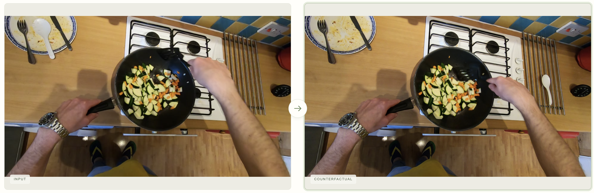
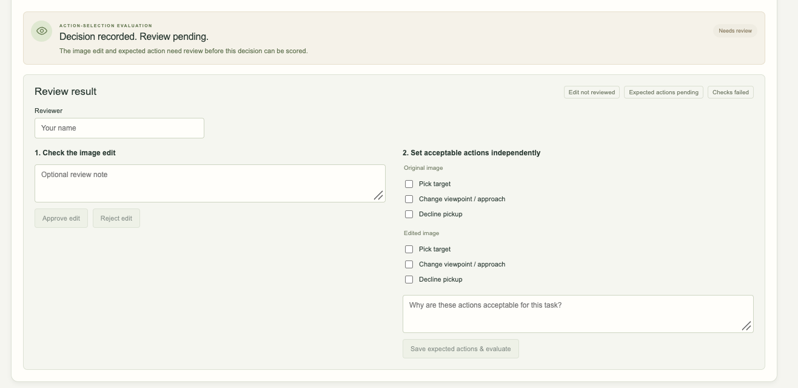
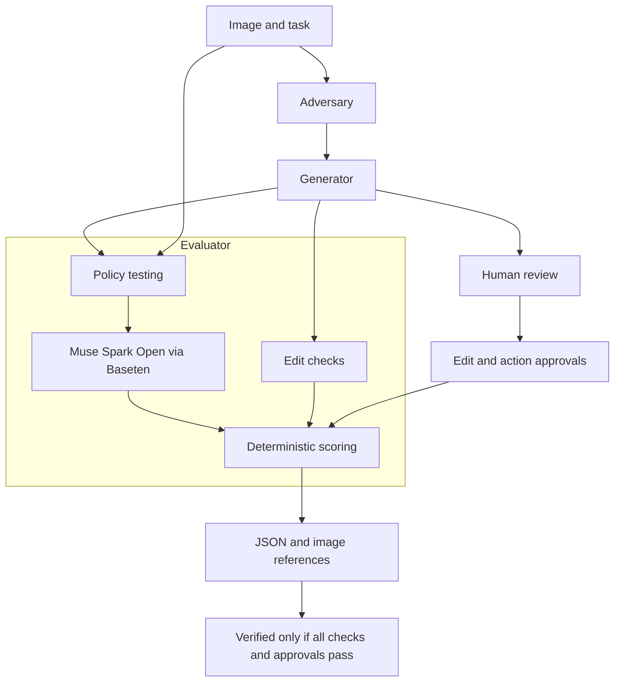

<h1 align="center">Whatiff</h1>

<h3 align="center">Intelligent Data Generation for Physical AI to Prevent Real-World Failures</h3>

[](https://youtu.be/sJOoJy0t5pw)

<p align="center">
  <a href="https://youtu.be/sJOoJy0t5pw">Demo Video</a> · X Thread
</p>

## Meta Global AI Hackathon 2026: Submission Overview

- **Track:** Startup
- **Theme:** Push the Frontier
- **Development period:** October 26 to November 4, 2026 (submission window).
  Built 100% from scratch during the hackathon window
- **Meta AI runtime models:**
  - Muse Spark 1.3: Adversary scenario planning.
  - Muse Image 1.0: Scene editing.
  - SAM 3.1: Optional object grounding and validation support.
  - Muse Spark Open (`meta-models/muse-spark-open-1026`) via Baseten:
    load-bearing action-selection policy within the Evaluator.
  - Deterministic scoring: Independent evaluation logic, not an AI model.
- **Bonus categories targeted:** Best Build on Meta Open Weight Models and
  Best Agentic Use-Case. 
- **Quickstart:** [Local setup and keyless replay](#quickstart).


## 
A robot trained to pick up objects may work perfectly until a target is partially hidden, another object looks similar, or something moves unexpectedly. Testing these cases in the real world requires repeatedly setting up scenes, operating robots, and collecting data. Rare failures are even harder to capture because they cannot be reproduced on demand.

Synthetic data can fill these gaps, but generating more data is not enough. The  challenge is knowing which scenarios are valid, which ones expose robot weaknesses, and which results can be trusted.

**Whatiff** turns existing robot observations into new test scenarios, evaluates how robots respond, and verifies the results. Each scenario comes with evidence of what changed, how the robot responded, and whether the data is suitable for evaluation.

Result? **More useful test data, faster discovery of robot weaknesses, and fewer unexpected failures in the real world.**

### Scenario Generation and Robot Evaluation

In this cooking example, the robot's task is to pick up a spoon to stir vegetables in a pan. Whatiff generates three alternative scenarios to test how the robot responds to changes in the scene:

- **Occlusion:** Partially hides the spoon to test whether the robot can still identify it.
- **Distractor:** Introduces a similar object to test whether the robot can distinguish the intended target.
- **Relocation:** Moves the spoon from the plate to the metal rack beside the stove to test whether the robot can identify it in a new location.

In the selected relocation scenario, the Evaluator uses Muse Spark Open through Baseten. **The policy selects `PICK_TARGET` and identifies the relocated spoon on the metal rack.** This demonstrates target recognition in the generated observation, not successful physical pickup.

Whatiff records the original and modified images, policy decisions, and validation evidence for all three scenarios. Each remains **Needs Review** until the required checks and independent action criteria are satisfied.


### Human Review and Data Verification

Whatiff automatically checks generated scenarios for validity and evaluates robot decisions against predefined criteria. A human reviewer has the final go/no-go decision on accepting the data. In this cooking example, the reviewer can inspect the modified scene, confirm the intended changes, and independently approve acceptable robot actions. Scenarios that fail required checks or lack sufficient evidence remain inconclusive, even with human approval.




## Why It Matters

Robotics developers, Physical AI labs, and AI data providers need varied
observations and defensible labels. Collecting every occlusion or object change
in the physical world takes time; manually checking generated scenes adds another
review burden.

Whatiff could support paid evaluation and data curation workflows: create
controlled variations, retain policy responses, and export reviewable records.
Customers could investigate weaknesses before committing to expensive physical tests. 

## How It Works

1. **Generate:** Adversary proposes changes; Generator edits the observation.
2. **Test:** Evaluator sends each image and task independently to the policy.
3. **Verify:** Check the edit and separately review expected-action criteria.
4. **Export:** Download compact JSON with actions, outcomes, image references,
   verification status, and evidence identifiers. Unverified records stay labeled.



## Generated data and export

**Export JSON** downloads the compact evaluation record. The **Generated Data**
path at the bottom opens that run's folder in Finder on macOS. On Linux/WSL, open
the displayed path manually; that shortcut is macOS-specific.

Each run is stored under `data/web/<run-id>/`:

| File | Purpose |
| --- | --- |
| `evaluation.json` | Compact task/model, image references/actions, scenarios, approval and verification states, outcomes, short reasons, stable evidence IDs |
| `original.png`, `counterfactual-0.png` through `counterfactual-2.png` | Original and generated images |
| `report.json` | Internal detailed evidence, dimensions, checks, approval history |
| Other files/subdirectories | Internal checkpoints, prompts, settings, and raw responses for live runs |

Image paths in the compact JSON are relative; keep it beside the images. Evidence
IDs use `whatiff:<run-id>:<case-id>`. Replay creates a fresh run; reviews persist in
that run. Runtime data is ignored by Git, so back up run folders to retain it.
Legacy reports are archived before correcting task-mismatched criteria.

## Measured Results and Limitations

| Evidence | Observation | Scope |
| --- | --- | --- |
| [Portable synthetic fixture](examples/controlled-example.json) and [review](examples/controlled-review.json) | Recorded hosted Muse Spark chose `PICK_TARGET` before and after partial mug occlusion; Pass under the independent invariance criterion | Verified synthetic image-level case; pixels outside the edit region preserved |
| [Bundled real-image replay](examples/washing-dishes-run/) | Hosted Meta policy decisions and three Muse Image edits are recorded; evaluations remain Inconclusive | Resolution changed; expected actions need independent approval |
| Local Baseten live validation | Four policy calls: original `PICK_TARGET`; edits `PICK_TARGET`, `ABSTAIN`, `PICK_TARGET`. All three evaluations Inconclusive | One washing-dishes run; eight audited calls total, including one hosted planner and three Muse Image calls. Full audit remains in ignored local runtime data, not the bundled replay |
| Automated validation at this revision | 114 backend tests and 10 browser tests passed; one API-calling browser test skipped in the latest suite | Backend inference is mocked. The separate preceding live browser run passed; it is not evidence of physical execution |

Replay the synthetic case without credentials:

```sh
.venv/bin/python -m whatiff.demo --example examples/controlled-example.json
```

### Interpreting results

Expand **Why this action?** for a policy explanation. Review image edits and
expected actions separately. Expected actions are task-specific, human-defined,
and initially unapproved; model predictions never define ground truth.

- **Pass:** action matches an approved criterion for a validated edit.
- **Potential Failure:** action violates an approved criterion for a validated edit.
- **Needs review:** UI label for an `inconclusive` evaluation.

The included real-image replay is **not verified**: generated images changed
resolution, and expected actions require independent approval. Approval controls
remain available, but failed checks persist and cannot establish a verified result.
No resolution normalization is performed. Physical execution, grasp success,
general robustness, and training suitability have not been validated. No policy
failure is manufactured.

## Meta Model Integration and Three-Agent Architecture

| Agent | Model/tool | Responsibility |
| --- | --- | --- |
| Adversary | Hosted Muse Spark 1.3 | Scenario planning and hypotheses; never ground truth |
| Generator | Muse Image 1.0; optional SAM 3.1 | Image edits and grounding; the controlled synthetic path uses SAM + Pillow |
| Evaluator | Muse Spark Open via Baseten, then deterministic scoring | Test the policy on original and modified observations; score against independent criteria |

The policy is the system under test, not a fourth agent. Muse Spark Open is
load-bearing in the default live workflow: both original and edited observations
must produce policy responses for evaluation to complete. It receives only one
image, the task, and fixed action definitions/instructions—never intervention
metadata, Adversary predictions, or expected answers. It does not verify edits or
define scoring criteria. Model and provider are recorded in metadata and exports.

Hosted Muse Spark 1.3 remains an explicitly selected policy fallback. Baseten
failure stops the run and identifies the provider; no silent fallback occurs.
Replay retains its original hosted-model provenance and makes no inference calls.
The open model is served by Baseten; Whatiff does not self-host weights. This
functional role supports the targeted open-weight bonus, while the three-agent
workflow supports the agentic category; neither award eligibility is guaranteed.

## Quickstart

### Prerequisites

- Python 3.9+ with `venv` and `pip`.
- Node.js 18+ and npm.
- A modern browser. Commands below work on macOS, Linux, or Windows with WSL.
- Internet to install dependencies. Replay needs no API key or model calls.

### Run locally - no API key required

Clone this repository (or download its ZIP), open a terminal in its root, and run:

```sh
python3 -m venv .venv
.venv/bin/python -m pip install --upgrade pip
.venv/bin/python -m pip install -e '.[test]'
npm ci
npm run build
.venv/bin/python -m whatiff.web
```

Keep that terminal running. Open **http://127.0.0.1:8790** and click
**Replay saved example**. It shows the washing-dishes input, three counterfactuals,
and policy decisions **recorded from live Meta API calls**. **Replay itself makes
zero model calls** and works offline after installation. Live execution is disabled
without the keys for the selected providers. Stop with Ctrl+C. If port 8790 is busy, stop its other process first.

Images, recorded state, hashes, and referenced audit files are included in
[examples/washing-dishes-run](examples/washing-dishes-run/). Replay does not depend
on ignored local data, credentials, or the original recording machine. The other
selectable kitchen photos are included locally too.

### Optional live Meta calls with your own keys

Create the local configuration once:

```sh
cp -n .env.example .env
```

Edit `.env` and replace the placeholder with your own key:

```dotenv
MODEL_API_KEY=your_meta_model_api_key_here
BASETEN_API_KEY=your_baseten_api_key_here
```

Do not overwrite an existing configured file. Restart the server, refresh the
page, choose an image/task, and click **Run Experiments**. The default live policy is Muse Spark Open (`meta-models/muse-spark-open-1026`)
through Baseten Chat Completions at `https://inference.baseten.co/v1`, using
`BASETEN_API_KEY` from `.env`. Scenario planning remains hosted Muse Spark 1.3;
generation remains Muse Image, with optional SAM grounding, using `MODEL_API_KEY`.
All inference models are Meta models. Calls consume the relevant provider quotas.
Never commit a populated `.env`; credential files are ignored by Git.

In **Change task, image or generator**, **Evaluator policy** explicitly selects
Baseten (default) or hosted Muse Spark as a fallback. A Baseten failure stops the
run and identifies Baseten; there is no automatic fallback. Retry keeps the
original provider. Recorded replay uses its recorded hosted Meta decisions and
makes no new calls; it is never relabeled as a Baseten run.

## Tests

In a second terminal with the app running:

```sh
.venv/bin/python -m unittest discover -s tests -q
npx playwright install chromium
npm run test:browser
```

Linux CI may need `npx playwright install --with-deps chromium`. Browser tests use
Playwright's installed Chromium; `CHROME_PATH` can optionally select another Chrome.
Python tests use mocks. The ordinary browser suite checks replay, review, compact
export, input handling, and mobile layout without model calls.

Explicit opt-in for the live API test, only with your own configured key:

```sh
env WHATIFF_LIVE_TEST=1 npm run test:browser
```

Live validation is separate from mock tests; latency and provider access vary.

## Attribution and demo

Kitchen images are frames from
[awsaf49/epic_kitchens_100](https://huggingface.co/datasets/awsaf49/epic_kitchens_100),
EPIC-KITCHENS by Dima Damen et al., licensed **CC BY-NC 4.0**. See
[source videos, timestamps, and modifications](public/examples/SOURCES.md).
The noncommercial restriction applies to these images; generated edits are derived
from them. No dataset affiliation or endorsement is implied.

Follow the [three-minute presenter script](docs/demo-script.md). Hosting is not
required. Clearly distinguish replayed decisions from optional fresh live calls.

<a id="demo-video"></a>
**Demo video:** [Watch on YouTube](https://youtu.be/sJOoJy0t5pw). Use recorded replay for a predictable presentation;
fresh live inference depends on provider access and latency.
