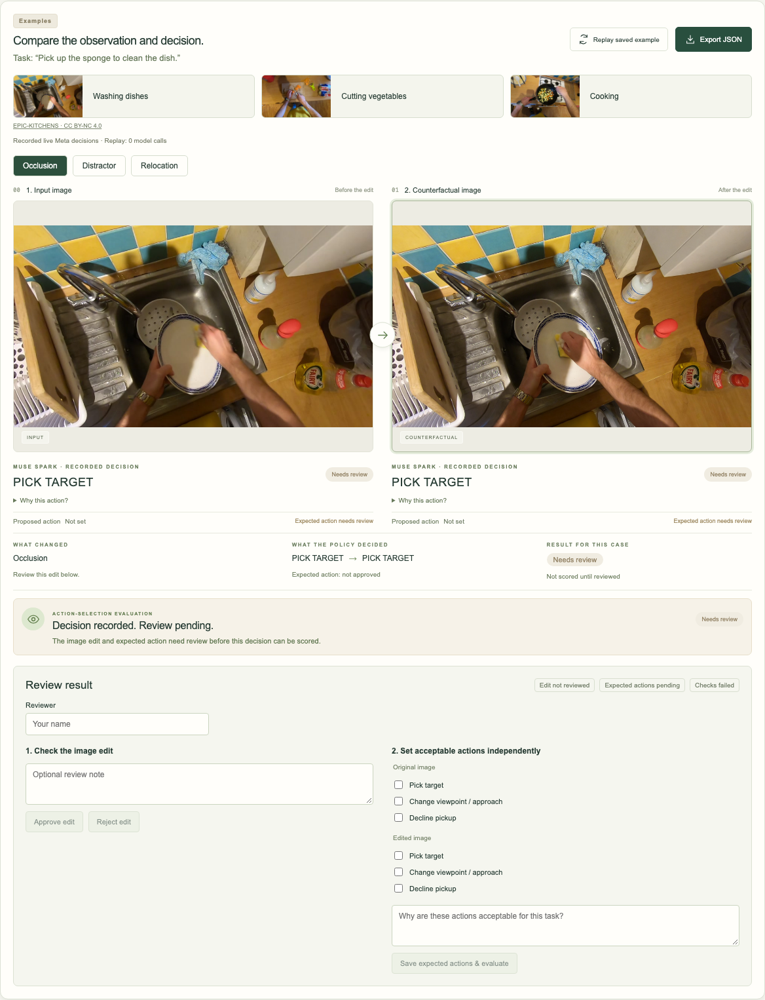

# Whatiff | Verified Data for Physical AI

Agentic counterfactual data generation and evaluation for embodied AI. Compare a
real first-person observation with generated edits and recorded policy decisions.



## Prerequisites

- Python 3.9+ with `venv` and `pip`.
- Node.js 18+ and npm.
- A modern browser. Commands below work on macOS, Linux, or Windows with WSL.
- Internet to install dependencies. Replay needs no API key or model calls.

## Run locally — no API key required

Clone this repository (or download its ZIP), open a terminal in its root, and run:

```sh
python3 -m venv .venv
.venv/bin/python -m pip install --upgrade pip
.venv/bin/python -m pip install -e '.[test]'
npm ci
npm run build
.venv/bin/python -m whatiff.web
```

Keep that terminal running. Open **http://127.0.0.1:8790** and click
**Replay saved example**. It shows the washing-dishes input, three counterfactuals,
and policy decisions **recorded from live Meta API calls**. **Replay itself makes
zero model calls** and works offline after installation. Live execution is disabled
without the keys for the selected providers. Stop with Ctrl+C. If port 8790 is busy, stop its other process first.

Images, recorded state, hashes, and referenced audit files are included in
[examples/washing-dishes-run](examples/washing-dishes-run/). Replay does not depend
on ignored local data, credentials, or the original recording machine. The other
selectable kitchen photos are included locally too.

## Optional live Meta calls with your own key

Create the local configuration once:

```sh
cp -n .env.example .env
```

Edit `.env` and replace the placeholder with your own key:

```dotenv
MODEL_API_KEY=your_meta_model_api_key_here
BASETEN_API_KEY=your_baseten_api_key_here
```

Do not overwrite an existing configured file. Restart the server, refresh the
page, choose an image/task, and click **Run Experiments**. The default live policy is Muse Spark Open (`meta-models/muse-spark-open-1026`)
through Baseten Chat Completions at `https://inference.baseten.co/v1`, using
`BASETEN_API_KEY` from `.env`. Scenario planning remains hosted Muse Spark 1.3;
generation remains Muse Image, with optional SAM grounding, using `MODEL_API_KEY`.
All inference models are Meta models. Calls consume the relevant provider quotas.
Never commit a populated `.env`; credential files are ignored by Git.

In **Change task, image or generator**, **Evaluator policy** explicitly selects
Baseten (default) or hosted Muse Spark as a fallback. A Baseten failure stops the
run and identifies Baseten; there is no automatic fallback. Retry keeps the
original provider. Recorded replay uses its recorded hosted Meta decisions and
makes no new calls; it is never relabeled as a Baseten run.

Exactly three agents remain: Adversary plans, Generator edits/grounds, and Evaluator
tests the isolated policy then scores it deterministically. Muse Spark Open is used
only in Evaluator policy testing. It receives one image, the task, and fixed action
definitions/instructions, never proposals or expected answers. The model and
provider are saved in evaluation metadata and compact exports.

### Meta Open Weight Models bonus

Muse Spark Open is load-bearing: both original and edited observations must pass
through it for live action-selection evaluation to complete. Its decisions feed
independent deterministic scoring; it is not a decorative extra call. This use is
intended for consideration in **Best Build on Meta Open Weight Models**. The open
model is served by Baseten; the app does not claim to self-host its weights.
Final bonus eligibility is determined by the organizers.

## Review and limitations

Expand **Why this action?** for a policy explanation. Review image edits and
expected actions separately. Expected actions are task-specific, human-defined,
and initially unapproved; model predictions never define ground truth.

- **Pass:** action matches an approved criterion for a validated edit.
- **Potential Failure:** action violates an approved criterion for a validated edit.
- **Needs review:** UI label for an `inconclusive` evaluation.

The included real-image replay is **not verified**: generated images changed
resolution, and expected actions require independent approval. Approval controls
remain available, but failed checks persist and cannot establish a verified result.
No resolution normalization is performed. Physical execution, grasp success,
general robustness, and training suitability have not been validated. No policy
failure is manufactured.

## Generated data and export

**Export JSON** downloads the compact evaluation record. The **Generated Data**
path at the bottom opens that run's folder in Finder on macOS. On Linux/WSL, open
the displayed path manually; that shortcut is macOS-specific.

Each run is stored under `data/web/<run-id>/`:

| File | Purpose |
| --- | --- |
| `evaluation.json` | Compact task/model, image references/actions, scenarios, approval and verification states, outcomes, short reasons, stable evidence IDs |
| `original.png`, `counterfactual-0.png` through `counterfactual-2.png` | Original and generated images |
| `report.json` | Internal detailed evidence, dimensions, checks, approval history |
| Other files/subdirectories | Internal checkpoints, prompts, settings, and raw responses for live runs |

Image paths in the compact JSON are relative; keep it beside the images. Evidence
IDs use `whatiff:<run-id>:<case-id>`. Replay creates a fresh run; reviews persist in
that run. Runtime data is ignored by Git, so back up run folders to retain it.
Legacy reports are archived before correcting task-mismatched criteria.

## Tests

In a second terminal with the app running:

```sh
.venv/bin/python -m unittest discover -s tests -q
npx playwright install chromium
npm run test:browser
```

Linux CI may need `npx playwright install --with-deps chromium`. Browser tests use
Playwright's installed Chromium; `CHROME_PATH` can optionally select another Chrome.
Python tests use mocks. The ordinary browser suite checks replay, review, compact
export, input handling, and mobile layout without model calls.

Explicit opt-in for the live API test, only with your own configured key:

```sh
env WHATIFF_LIVE_TEST=1 npm run test:browser
```

Live validation is separate from mock tests; latency and provider access vary.

## Attribution and demo

Kitchen images are frames from
[awsaf49/epic_kitchens_100](https://huggingface.co/datasets/awsaf49/epic_kitchens_100),
EPIC-KITCHENS by Dima Damen et al., licensed **CC BY-NC 4.0**. See
[source videos, timestamps, and modifications](public/examples/SOURCES.md).
The noncommercial restriction applies to these images; generated edits are derived
from them. No dataset affiliation or endorsement is implied.

Follow the [three-minute presenter script](docs/demo-script.md). Hosting is not
required. Clearly distinguish replayed decisions from optional fresh live calls.
This repository does not claim a completed or uploaded submission video.
